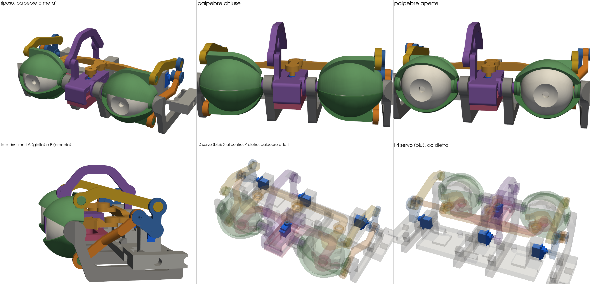
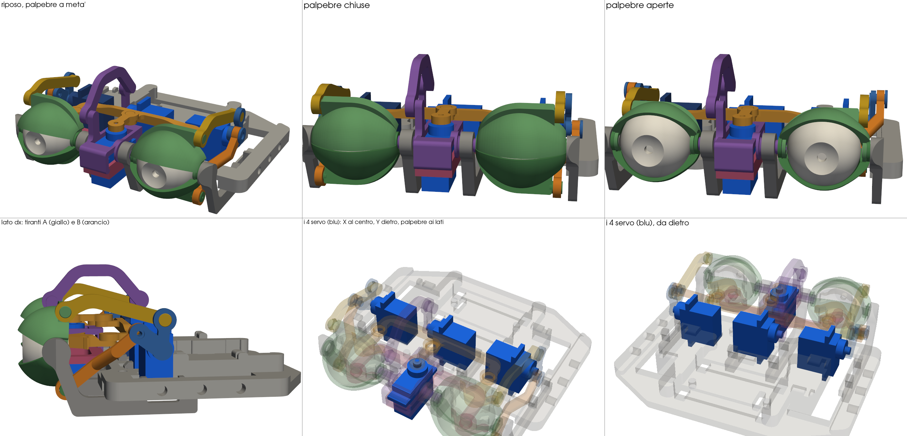

# Occhi animatronici — note di progetto

Due modelli di partenza (in `mechanical/eyes/original/`) e una versione in uso, in due taglie:

| Cartella | Cosa |
|---|---|
| `original/eyemech_e3.2/` | **EyeMech ε3.2** di Will Cogley (3MF, PDF di montaggio, codice, scheda). Base della versione in uso |
| `original/morganmanly/` | **Animatronic Eyes – Double and Single** di MorganManly (`single_v4`, `double_compact`). Da qui viene l'idea delle palpebre a 1 servo per occhio |
| `eyemech_D85/` | **versione in uso**: EyeMech ingrandito, occhi a 200 mm tra i centri (bulbo Ø85.3), palpebre a 1 servo per occhio, sedi dei servo 1:1 |
| `eyemech_D32_prova/` | **versione di prova**: gli stessi pezzi nella scala di Will (bulbo Ø32, occhi a 75 mm), da stampare per prima |

Generatore unico: `mechanical/scripts/generate_eyemech.py`.

## Versione EyeMech D85 — pezzi originali di Will, palpebre a 1 servo (4 servo SG90/MG90S)
File in `mechanical/eyes/eyemech_D85/`; in `print_A1/` gli stessi pezzi grandi già disposti sui
piatti della Bambu A1 (256 × 256).



Parte dai pezzi **originali** di EyeMech ε3.2 (`EyeMech e3.2 SG90 - A.3mf`, versione print-in-place,
sedi SG90 lettera A) e li ingrandisce tutti dello stesso fattore **s = 200/75 = 2.667**, scelto perché i centri degli occhi
siano a **200 mm** (in Will sono a 75 mm); il bulbo viene Ø85.3. Bulbi, base
con gli incastri, supporti a L, telaio centrale X/Y, palpebre e tiranti. Un incastro
a scatto ingrandito lavora con la stessa deformazione dell'originale; i giochi dei perni
print-in-place passano da ~0.2 a ~0.5 mm (stessa proporzione).

Cambia solo quello che non si può ingrandire o che riguarda le palpebre:

| Cosa | Come |
|---|---|
| Sedi dei servo | **1:1**, per SG90/MG90S veri (22.8 × 12.4 mm, orecchie 32.6 mm, fori a 27.8 mm), ricavate direttamente nei pezzi: le sedi ingrandite di Will sono riempite e dentro c'è la sede del servo vero, con l'albero sull'asse della squadretta e la faccia superiore alla stessa quota (i mozzi delle squadrette non cambiano). Base: 3 sedi (Y al centro, palpebre sx e dx), il servo entra **di fianco, dal lato della squadretta**, le orecchie appoggiano sulla faccia del blocco, 2 viti M2×8 autofilettanti. `XAxisA`: sede del servo X nel telaio, il servo entra **dall'alto** come in Will, orecchie sul piano, 2 viti M2×8. Cavo: canale sotto il fondo del corpo, esce dall'altra parte del blocco. Niente gusci né fermi di Will |
| Box del `CoreY` (sopra il servo X) | in Will ha una piastra con la finestra del servo e sotto la cavità delle orecchie: ingranditi sarebbero 2.7 volte il servo. Riempiti, con la **finestra 1:1** attorno al servo vero; il riempimento appoggia 0.2 mm sopra le orecchie (le trattiene come nell'originale) e ha 2 fori per le teste delle viti M2 |
| Squadrette (palpebre, X, Y) | mozzo rifatto: codolo Ø10 che scende di 8.7 mm fino allo scanalato del servo vero, sede Ø4.75×3 a pressione + vite M2×12 |
| Palpebre | Will usa 2 servo per occhio. Resta solo il servo **anteriore** (quello della palpebra superiore, tirante corto originale). La sua squadretta ha un secondo braccio (r 35.1 mm, 58.8° avanti) con un perno; il nuovo tirante `LinkB` (interasse 104.9 mm) porta il moto all'orecchia della palpebra inferiore. Spingendo in avanti le due orecchie le palpebre si chiudono insieme |
| Servo posteriore | eliminato, con la sua squadretta e il tirante lungo. La sua sede ingrandita resta vuota |
| Base | **ridotta** a 388 × 80 × 67 mm: in Will teneva anche la scheda e i servo posteriori, qui deve solo tenere i supporti a L e i 3 servo. Resta la striscia y −38…−8 (quote 1:1) con le fessure dei supporti e i blocchi delle sedi (accorciati a 24 mm sotto le orecchie). Divisa a metà (x = 0), unita da 2 chiavette a coda di rondine sotto, con 2 viti M3×10 svasate ciascuna |
| Porta-PCB | non inclusi: ingranditi terrebbero una scheda di Will 2.7 volte più grande |

**Cinematica palpebre** (ottimizzata nello script): con 80° di corsa del servo la palpebra superiore fa
−35.5…+24.3° e l'inferiore +36.7…−21.4°: speculari entro 1°, come le due palpebre a servo separato
di Will (bordi a circa ±60° da aperte, a ~0° da chiuse). Gli angoli di trasmissione restano tra 54° e 90°.
Il `LinkB` parte dal lato esterno della squadretta (per non toccare il tirante originale vicino al giunto)
e rientra sul piano dell'orecchia a metà lunghezza, prima del supporto esterno.

**Verifica al computer**: nessuna interferenza tra palpebre, tiranti, squadretta, bulbo, supporti, base e
servo vero su tutta la corsa (da 4° oltre l'apertura fino a chiuse). I gruppi print-in-place
modificati non si compenetrano. Il lato sinistro è lo specchio del destro.

**Assieme X/Y**: nel 3MF di Will `CoreY`, `XAxisA` e `XAxisB` sono solo in posa di stampa; lo script li
monta ricavando la posa dai vincoli (perni del `CoreY` sull'asse degli occhi, anelli di `XAxisA` sotto i
centri dei bulbi, servo X dentro il box del `CoreY`, squadretta di `XAxisB` sull'albero). Con questa posa
il mozzo della squadretta Y cade esattamente sull'asse degli alberi delle palpebre (z 11.2), e in posa
neutra non c'è nessuna interferenza oltre agli incastri a scatto voluti. Nell'immagine le ultime due viste
mostrano i 4 servo (blu) con il resto trasparente.

### Cosa stampare (D85)
| File | Q.tà | Note |
|---|---|---|
| `Base_L`, `Base_R` | 1+1 | 194 × 80 × 67 mm ciascuna, stanno insieme su un piatto. Contengono le sedi 1:1 dei servo Y e palpebre (la sede Y è a cavallo della giunzione) |
| `BaseKey_x2` | 2 | chiavette sotto la giunzione, viti M3×10 svasate (4) |
| `PivotCentral_x2`, `PivotOuter_L`, `PivotOuter_R` | 2+1+1 | supporti a L |
| `Eyeball_x2` | 2 | bulbi di Will Ø85.3 (pochi perimetri, riempimento basso: pieni sarebbero ~200 g) |
| `CoreY_PIP` | 1 | telaio su/giù + squadretta Y (print-in-place); nel box la finestra 1:1 del servo X |
| `XAxisA_PIP`, `XAxisB_PIP` | 1+1 | asse X (print-in-place), in `XAxisA` la sede 1:1 del servo X. Lunghi 264 mm: **in diagonale** sul piatto da 256 (già fatto in `print_A1/P2`, `P3`) |
| `LidTop_L_PIP`, `LidTop_R_PIP` | 1+1 | palpebra superiore + tirante originale + squadretta nuova (print-in-place) |
| `LidBottom_L`, `LidBottom_R` | 1+1 | palpebra inferiore, perno dell'orecchia cilindrico Ø14 con foro per M3 |
| `LinkB_L`, `LinkB_R` | 1+1 | tirante nuovo: ha un tratto obliquo, serve supporto |
| `PinB_x2` | 2 | perno del secondo braccio (testa sul piatto), vite M3×20 |
| `Washer_x2` | 2 | rondella sull'orecchia della palpebra inferiore, vite M3×10 |

Orientamenti di stampa: quelli di Will (presi dal suo 3MF), solo ingranditi.
`print_A1/`: P1 = `Base_L` + `Base_R` + chiavette, perni e rondelle, P2 = `XAxisA`, P3 = `XAxisB`.
`bambu_A1/`: tutti i pezzi già tagliati in Bambu Studio su 8 piatti A1 (PLA, 0.20 mm): **≈ 30 h 20 min e
≈ 0.86 kg di filamento** in totale; tempi e grammi per piatto in `bambu_A1/README.md`.

### Montaggio
Come nella guida di Will (`mechanical/eyes/original/eyemech_e3.2/src/Assembly.pdf`), con queste differenze:
1. Servo X: dall'alto nella sede di `XAxisA` (cavo verso la tacca), 2 viti M2×8, poi si aggancia il `CoreY` sopra.
   Servo Y e palpebre: si infilano nella base **prima** di `PivotCentral` / `PivotOuter`, di fianco dal lato
   della squadretta, col cavo infilato prima nel canale sotto il corpo; 2 viti M2×8 nelle orecchie.
2. Palpebre: montare solo il servo anteriore di ogni lato (quello che Will chiama TOP LEFT / TOP RIGHT).
   La sede del servo posteriore resta vuota.
3. `LinkB`: anello esterno sul `PinB` (codolo nel foro del secondo braccio, vite M3×20 dall'esterno);
   anello interno sul perno dell'orecchia della palpebra inferiore, con `Washer` e vite M3×10.
4. Base: unire le due metà con le chiavette prima di montare il resto.

**Calibrazione**: come Will, servo a 90° = palpebre chiuse. Aperte: destra 90° → 10°, sinistra
90° → 170° (i canali TR/TL del suo codice; BR/BL non servono più). Il firmware deve gestire 4 servo
(`EyeNode_2servo` ne gestisce 2).

### Da verificare
- **Misure SG90** (`SG_*` e `SG_SPLINE_TOP`/`SG_BOSS_TOP` nello script, stimate da datasheet): provare
  una sede e una squadretta con un servo vero prima del resto.
- **Sedi X e Y**: le sedi di palpebre e Y prendono l'asse dal mozzo della loro squadretta; il servo X sta
  nella finestra di `XAxisA` (25.6 mm per un corpo di 22.8) a 0.75 mm dal lato posteriore, così il telaio
  laterale di `XAxisB` passa dietro le orecchie dei servo palpebre. Controllare al montaggio che i codoli
  delle squadrette non tocchino il mozzo ingranaggi.
- **Coppia**: i pezzi sono 2.7 volte più grandi e circa 19 volte più pesanti dell'originale. Gli
  **MG90S** sono consigliati (stesse sedi), soprattutto per palpebre e Y; stampare palpebre e bulbi leggeri.

## Versione di prova D32 — stessi pezzi, scala di Will
File in `mechanical/eyes/eyemech_D32_prova/`. Da stampare **prima** della D85: costa poco filamento e
qualche ora, e fa vedere se il meccanismo funziona davvero.



È la D85 senza l'ingrandimento (s = 1): bulbo Ø32, occhi a 75 mm, base 145 × 95 mm in un pezzo solo.
Siccome la scala è quella di Will, **sedi dei servo, squadrette, base e fermi sono i suoi originali**
(gli SG90/MG90S ci entrano come nel suo progetto). Cambiano, come nella D85, solo le palpebre:
un servo per occhio, secondo braccio sulla squadretta, `LinkB`, `PinB`, perno cilindrico
sull'orecchia della palpebra inferiore. Cinematica identica alla D85 (stessi angoli, interasse
`LinkB` 39.3 mm). I pezzi nuovi hanno quote ridotte a circa 3/8 e **viti M2** (`DIM["small"]` nello script).

**Cosa prova**: movimento delle palpebre a un servo (secondo braccio + `LinkB`), print-in-place,
assi X/Y, montaggio e firmware a 4 servo.
**Cosa non prova**: le sedi 1:1 e i mozzi rifatti della D85 (qui sono quelli di Will) e il peso
dei pezzi grandi.

### Cosa stampare (D32 prova)
| File | Q.tà | Note |
|---|---|---|
| `Base` | 1 | base di Will, 145 × 95 mm |
| `Retainer_Single`, `Retainer_Double_A`, `Retainer_Double_B` | 1+1+1 | fermi dei servo di Will |
| `PivotCentral_x2`, `PivotOuter_L`, `PivotOuter_R` | 2+1+1 | supporti a L |
| `Eyeball_x2` | 2 | bulbi di Will Ø32 |
| `CoreY_PIP`, `XAxisA_PIP`, `XAxisB_PIP` | 1+1+1 | assi X/Y di Will (print-in-place) |
| `LidTop_L_PIP`, `LidTop_R_PIP` | 1+1 | palpebra superiore + tirante + squadretta col secondo braccio |
| `LidBottom_L`, `LidBottom_R` | 1+1 | palpebra inferiore, perno dell'orecchia Ø5.6 |
| `LinkB_L`, `LinkB_R` | 1+1 | tirante nuovo, con supporto |
| `PinB_x2`, `Washer_x2` | 2+2 | pezzi piccoli (Ø9): ugello 0.4, layer 0.12–0.16 |

**Stampa** (`eyemech_D32_prova/bambu_A1/`, 5 piatti A1 già tagliati): **≈ 5 h 10 min e ≈ 118 g** di PLA.

Viti: per lato 1 × M2×8 nel `PinB` (si filetta nel braccio) + 1 × M2×5 con la rondella; il resto come
nella guida di Will. Montaggio: guida di Will + punti 2 e 3 della D85 (servo posteriore non montato).

## Rigenerare
```bash
pip install trimesh manifold3d numpy scipy shapely pyvista
python mechanical/scripts/generate_eyemech.py                       # D85: occhi a 200 mm (bulbo 85.3) + print_A1, con verifica
python mechanical/scripts/generate_eyemech.py --small               # versione di prova in scala di Will
python mechanical/scripts/generate_eyemech.py --interasse 210       # altra distanza tra i centri degli occhi
python mechanical/scripts/generate_eyemech.py --interasse 0 --d 90  # scala dal diametro del bulbo
python mechanical/scripts/generate_eyemech.py --render              # immagine in docs/img
```

## Licenza
Entrambi i modelli di partenza sono **CC BY-NC-SA 4.0** (attribuzione, **non commerciale**, condividi
allo stesso modo) e i file derivati qui sono soggetti alla stessa licenza. Un carro allegorico ha un
contesto commerciale/professionale: tutti i pezzi della versione in uso derivano da EyeMech ε3.2, quindi
per il carro serve il permesso di **Will Cogley** (enquiries@willcogley.com); l'idea delle palpebre
a 1 servo viene da MorganManly.
