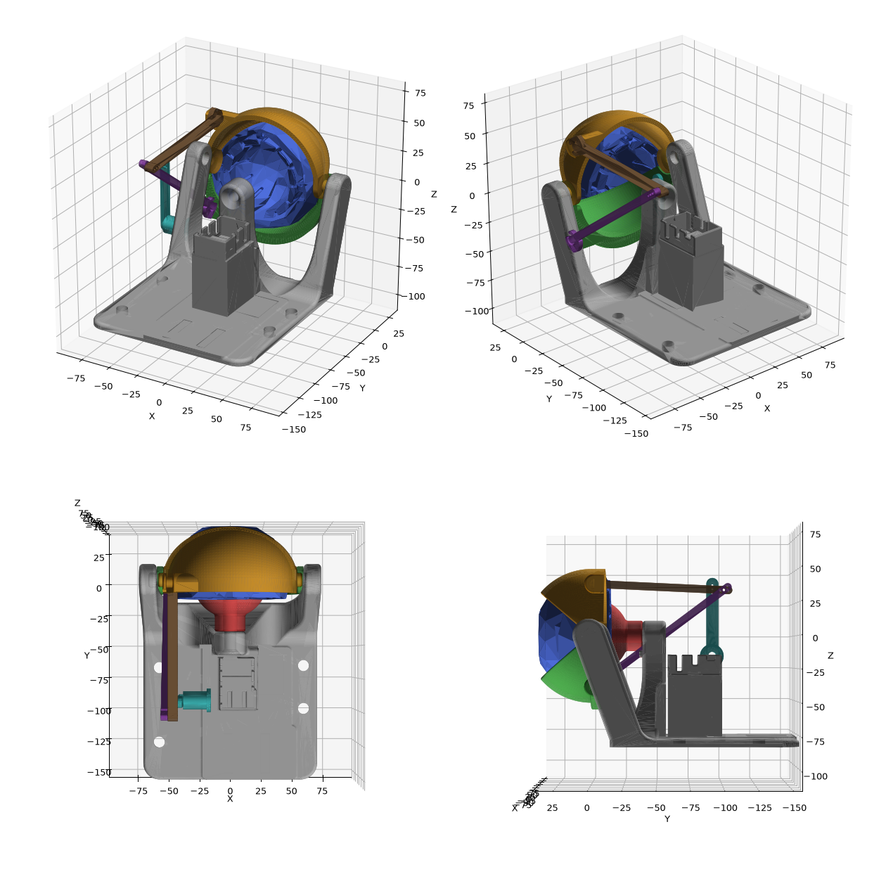
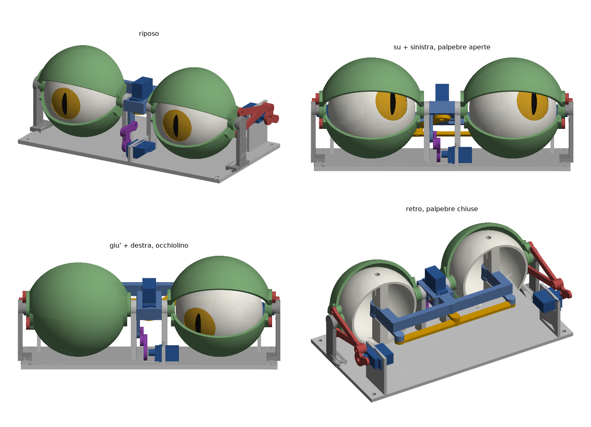
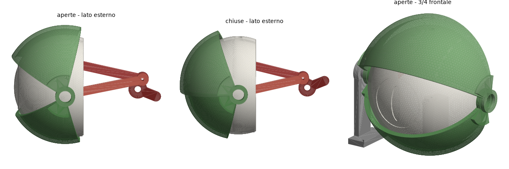

# Occhi animatronici ingranditi — note di progetto



## Cosa viene scalato e cosa no
Fattore `k = D / 35` (D50 → 1.43, D70 → 2.00, D90 → 2.57), centro di scala = centro occhio.

| Pezzo | Trattamento |
|---|---|
| Bulbo, snodo sferico, palpebre sup./inf. | scalati uniformemente di k |
| BasePlate: piastra, montanti palpebre, torre snodo | scalati di k |
| **BasePlate: vano servo** | **1:1 originale**, ritagliato e trapiantato dietro la torre, alla stessa quota rispetto al centro occhio, su un piedistallo |
| Tiranti palpebre | rigenerati: testa d'innesto scalata + corpo dritto + 3 fori di regolazione (±3 mm) |
| `LidCrank` (nuovo) | prolunga per la squadretta del servo palpebre: braccio di raggio k·r, così gli angoli servo restano quelli originali |
| `HornExtender` (nuovo) | prolunga per le squadrette dei 2 servo occhio, fila di fori ogni 2.5 mm per il filo |

Perché le prolunghe: con servo e squadrette 1:1 e leve sull'occhio k volte più grandi, la stessa
corsa del servo darebbe un angolo dell'occhio k volte minore. Allungando il braccio di k la
cinematica torna simile all'originale e la calibrazione (`calibration.ino`) resta valida come punto di partenza.

## Viteria e materiali per taglia
| | D50 | D70 | D90 |
|---|---|---|---|
| Vite snodo (orig. M3) | M4 + inserto M4 | M6 + inserto M6 | M8 + inserto M8 |
| Foro inserto nello snodo | 5.9 mm | 8.2 mm | 10.5 mm |
| Fori fissaggio piastra | 5.0 mm | 7.0 mm | 9.0 mm |
| Filo armonico occhio (orig. 1 mm) | 1.5 mm | 2.0 mm | 2.5 mm |
| Tiranti palpebre ↔ LidCrank | viti M2 | viti M2 | viti M2 |
| Raggio braccio palpebre | 27.9 mm | 39.1 mm | 50.2 mm |
| Ingombro BasePlate (X×Y×Z) | 77×94×53 | 108×131×74 | 138×168×95 |

La zona libera della piastra dietro al vano servo (molto ampia in D70/D90) è pensata per il
fissaggio della scheda di controllo.

## Montaggio — differenze rispetto all'originale
1. Servo, squadrette e vano: identici all'originale (MG90S consigliati).
2. Centrare i servo a 90° **prima** di montare le prolunghe (come da istruzioni originali).
3. `LidCrank`: appoggiarlo sulla squadretta del servo palpebre, forare Ø1.5 attraverso i fori della
   squadretta e fissare con 2 viti M2 autofilettanti; foro centrale Ø6.4 per la vite della squadretta.
   A 90° il braccio deve puntare verso l'alto.
4. Tiranti: una vite M2 lunga attraversa tirante inferiore, tirante superiore e braccio. Scegliere la
   coppia di fori (tirante/braccio) che dà palpebre centrate a servo a 90°.
5. `HornExtender`: stesso fissaggio sulla squadretta; il filo va nel foro al raggio ≈ k × raggio usato in origine.

## Da verificare con la prima stampa (consigliato: D50)
- Asse del servo palpebre stimato da foto e geometria (`LID_SERVO_AXIS` nello script): i fori di
  regolazione compensano ±3 mm, ma va confermato.
- Le tolleranze di stampa si scalano con k (giochi più ampi nelle taglie grandi): verificare
  l'innesto a scatto bulbo–snodo e palpebre–montanti.
- Coppia: con D90 i bulbi pesano ~5-6 volte l'originale; gli MG90S (2.2 kg·cm) restano nel margine
  per movimenti fluidi, ma evitare scatti troppo bruschi (ServoEasing).

## Licenza
Il progetto originale è **CC BY-NC-SA 4.0** (attribuzione, **non commerciale**, condividi allo stesso
modo). I file derivati qui sono soggetti alla stessa licenza. Un carro allegorico ha
un contesto commerciale/professionale: **chiedere il permesso all'autore (MorganManly)** prima dell'uso sul carro,
oppure ridisegnare da zero i pezzi.

## Versione COPPIA (double)
File in `mechanical/eyes/scaled/double/D50|D70|D90/`. Anteprima: `docs/img/confronto_taglie_coppia.png`.

- Base dalla versione "double compact" originale: due vani servo 1:1 (sx e dx speculare), vano
  centrale (supporti protoboard + foro connettore alimentazione) scalato di k.
- Pezzi `_x2` / `_x4` = da stampare 2 / 4 volte (bulbo, snodo, prolunghe squadrette).
- Pezzi `_L` / `_R` = occhio sinistro / destro (palpebre, tiranti, LidCrank speculari).

| | D50 | D70 | D90 |
|---|---|---|---|
| Interasse occhi | 94.0 mm | 131.6 mm | 169.2 mm |
| Ingombro BasePlate_Double (X×Y×Z) | 171×94×53 | 239×131×74 | **308**×168×95 |

⚠️ La BasePlate_Double D90 (308 mm) non entra nei piatti comuni (220–256 mm): va divisa in due
metà con giunzione (posso generarla con incastro a coda di rondine + viti) oppure si usano due
moduli singoli affiancati. La D70 (239 mm) entra in piatti da 256 mm (es. Bambu X1/P1).

## Versione COPPIA a 2 SERVO (asse X + palpebre sincronizzati)
File in `mechanical/eyes/scaled/double_2servo/D50|D70|D90/` (solo i pezzi **nuovi**).
Anteprima: `docs/img/assembly_double_2servo_D70.png`.

Gli occhi guardano solo a destra/sinistra, **insieme**, e le palpebre dei due occhi si muovono
**insieme**. Servono 2 servo veri, entrambi sull'occhio sinistro:

| Sede servo | Occhio sx | Occhio dx |
|---|---|---|
| sx/dx (asse X) | **servo vero** + `HornExtender_Tie` | servo finto + `HornExtender_Pivot` (trascinato dal tirante) |
| su/giù | servo finto + `HornExtender_Pivot` **bloccato** (occhio fermo in verticale) | servo finto + `HornExtender_Pivot` **bloccato** |
| palpebre | **servo vero** + `LidCrank_L` (da `double/`) | servo finto + `LidCrank_R_Pivot` |

**Cosa stampare**
- Da `double/Dxx/`: `BasePlate_Double`, `Eyeball_x2`, `EyeBall_Ball_Joint_x2`, le 4 palpebre, i 4
  tiranti, `LidCrank_L`. **Non** servono `LidCrank_R` e `HornExtender_x4`.
- Da `double_2servo/Dxx/`: `DummyServo_MG90S_x4`, `HornExtender_Tie` (×1), `HornExtender_Pivot_x3`,
  `LidCrank_R_Pivot`, `LidBail`.

**Pezzi nuovi**
- `DummyServo_MG90S`: "servo finto" con la forma di un MG90S. Va nella sede del servo eliminato e
  fa da perno: vite M3 × 40 dal basso (dado M3 nell'incavo del fondo) con la squadretta/manovella
  libera di girare sopra. Le quote MG90S sono stimate da disegni generici: **misurare un servo vero
  col calibro** e, se serve, correggere le costanti `DUMMY_*` nello script prima di stamparne 4.
- `LidBail`: barra a U che unisce rigidamente le due manovelle palpebre (sono coassiali). Le
  alette si avvitano sul lato interno dei bracci con le stesse viti M2 dei tiranti, **due fori per
  lato** (es. r e r+3) così l'unione è rigida. La barra trasversale è spostata di 10° verso il retro.
  Verificata al computer: nessuna interferenza con piastra, bulbi e palpebre su ±60° di corsa, in
  tutte e tre le taglie (l'originale usa ~70° in tutto). Stampa coricata su un
  fianco (D90: 241 mm, serve un piatto da 256 mm).
- `HornExtender_Tie` / `_Pivot`: prolunga con un secondo braccio a 90°. Sull'occhio sx va sulla
  squadretta del servo vero, sull'occhio dx sul servo finto. I due bracci "tirante" devono essere
  **paralleli e rivolti nello stesso verso** (es. entrambi verso il retro) e vanno uniti da un
  tirante in filo armonico (stesso diametro del filo occhio) piegato a Z alle estremità, lungo
  quanto la distanza tra gli assi dei due servo sx/dx (parallelogramma). Capovolgendo la prolunga
  il braccio passa dall'altro lato.
- Bloccaggio su/giù: centrare l'occhio, poi forare Ø1.5 attraverso un foro della prolunga nel servo
  finto e fissare con una vite M2 autofilettante (più una goccia di colla).

**Da verificare con la prima stampa (D50)**
- Percorso del tirante X: la barra palpebre è verificata, il tirante X no (la posizione esatta
  degli alberi sx/dx nel vano 1:1 non è nota dal modello). Va controllato a mano che non tocchi i
  fili dell'occhio o i supporti centrali in tutta la corsa.
- Coppia: un solo MG90S muove ora **4 palpebre** e uno solo **2 bulbi**. Con D70/D90 rallentare i
  movimenti (ServoEasing) e, se il servo palpebre fatica, passare a un servo più forte con la
  stessa sede (es. MG90D / EMAX ES08MA II, da verificare dimensioni).

## Versione COPPIA a 2 servo **MG995**
File in `mechanical/eyes/scaled/double_2servo_mg995/D50|D70|D90/`.
Anteprima: `docs/img/assembly_double_mg995_D70.png`.

Stesso comportamento della versione a 2 servo (sx/dx insieme, palpebre insieme), ma con due MG995
(formato standard, ~10 kg·cm) al posto degli MG90S. Gli MG995 non entrano nei vani 1:1, quindi la
piastra è nuova (`BasePlate_Double_MG995`): i vani MG90S sono eliminati e non servono servo finti.

| Funzione | Come |
|---|---|
| Occhi sx/dx | MG995 **al centro**, albero verticale, con `XHorn_MG995` (squadretta doppia). Due tiranti in filo armonico, paralleli all'asse Y, vanno agli attacchi laterali **interni** dei due bulbi (foro verticale): i bulbi girano insieme. |
| Palpebre | MG995 accanto all'occhio sx, albero coassiale alle manovelle (al posto del servo palpebre sx). `LidCrank_L` (da `double/`) sulla sua squadretta, `LidBail` porta il moto alla `LidCrank_R_Pivot`, che gira su un perno M3 ricavato nella piastra. |
| Su/giù | Bloccato: tirante fisso in filo armonico dall'attacco superiore del bulbo al foro del montante basso dietro la torre dello snodo (lunghezza in `info.txt`). |

**Cosa stampare**: da `double_2servo_mg995/Dxx/` tutto; da `double/Dxx/` bulbi, snodi, palpebre,
tiranti palpebre e `LidCrank_L`.

**Verifiche fatte al computer** (tutte le taglie): nessuna interferenza della squadretta doppia su
±40°, dei tiranti X con occhi a ±30°, del tirante su/giù con le palpebre su ±60°; `LidBail` libera
su ±60° (D50: da −60° a +50°). La `LidBail` ha la barra spostata di 10° verso il retro per non
toccare le torri degli snodi a palpebre chiuse. Il corpo dell'MG995 centrale taglia i supporti
della protoboard nel vano centrale (non servono più).

**Prima di stampare la piastra**: misurare un MG995 col calibro e confrontare con le costanti
`MG995_*` nello script (corpo 40.7 × 19.7, altezza cassa 42.9, faccia squadretta a 48.0 dal fondo,
orecchie a 26.5–29.0, fori 49.5 × 10, asse a 10.0 dall'estremità). Se differiscono, correggerle e
rigenerare con `python mechanical/scripts/generate_eyes.py --mg995`.

**Elettrico**: un MG995 assorbe fino a ~1.5–2.5 A in stallo (contro ~0.9 A dell'MG90S). Con 2 MG995
per testa il picco è ~5 A a 6 V: il DC-DC da 10 A per testa basta, il fusibile a lama da 7.5 A
sulla scheda pure.

## Versione EyeMech D85 — pezzi originali di Will, palpebre a 1 servo (4 servo SG90/MG90S)
File in `mechanical/eyes/scaled/eyemech/D85/`. Generatore: `mechanical/scripts/generate_eyemech_D85.py`.
**Sostituisce l'ibrido** qui sotto (che aveva bulbi, base e sedi ridisegnati da zero).


Parte dai pezzi **originali** di EyeMech ε3.2 (`EyeMech e3.2 SG90 - A.3mf`, versione print-in-place,
sedi SG90 lettera A) e li ingrandisce tutti dello stesso fattore **s = 200/75 = 2.667**, scelto perché i centri degli occhi
siano a **200 mm** (in Will sono a 75 mm); il bulbo viene Ø85.3. Bulbi, base
con gli incastri, supporti a L, telaio centrale X/Y, palpebre e tiranti. Un incastro
a scatto ingrandito lavora con la stessa deformazione dell'originale; i giochi dei perni
print-in-place passano da ~0.2 a ~0.5 mm (stessa proporzione).

Cambia solo quello che non si può ingrandire o che riguarda le palpebre:

| Cosa | Come |
|---|---|
| Sedi dei servo | **1:1**, per SG90/MG90S veri (22.8 × 12.4 mm, orecchie 32.6 mm, fori a 27.8 mm), ricavate direttamente nei pezzi: le sedi ingrandite di Will sono riempite e dentro c'è la sede del servo vero, con l'albero sull'asse della squadretta e la faccia superiore alla stessa quota (i mozzi delle squadrette non cambiano). Base: 3 sedi (Y al centro, palpebre sx e dx), il servo entra **di fianco, dal lato della squadretta**, le orecchie appoggiano sulla faccia del blocco, 2 viti M2×8 autofilettanti. `XAxisA`: sede del servo X nel telaio, il servo entra **dall'alto** come in Will, orecchie sul piano, 2 viti M2×8. Cavo: canale sotto il fondo del corpo, esce dall'altra parte del blocco. Niente più gusci né fermi di Will |
| Squadrette (palpebre, X, Y) | mozzo rifatto: codolo Ø10 che scende di 8.7 mm fino allo scanalato del servo vero, sede Ø4.75×3 a pressione + vite M2×12 |
| Palpebre | Will usa 2 servo per occhio. Resta solo il servo **anteriore** (quello della palpebra superiore, tirante corto originale). La sua squadretta ha un secondo braccio (r 35.1 mm, 58.8° avanti) con un perno; il nuovo tirante `LinkB` (interasse 104.9 mm) porta il moto all'orecchia della palpebra inferiore. Spingendo in avanti le due orecchie le palpebre si chiudono insieme |
| Servo posteriore | eliminato, con la sua squadretta e il tirante lungo. La sua sede ingrandita resta vuota |
| Base | 388 × 253 × 70 mm: divisa a metà (x = 0), unita da 3 chiavette a coda di rondine sotto, con 2 viti M3×10 svasate ciascuna |
| Porta-PCB | non inclusi: ingranditi terrebbero una scheda di Will 2.7 volte più grande |

**Cinematica palpebre** (ottimizzata nello script): con 80° di corsa del servo la palpebra superiore fa
−35.5…+24.3° e l'inferiore +36.7…−21.4°: speculari entro 1°, come le due palpebre a servo separato
di Will (bordi a circa ±60° da aperte, a ~0° da chiuse). Gli angoli di trasmissione restano tra 54° e 90°.
Il `LinkB` parte dal lato esterno della squadretta (per non toccare il tirante originale vicino al giunto)
e rientra sul piano dell'orecchia a metà lunghezza, prima del supporto esterno.

**Verifica al computer**: nessuna interferenza tra palpebre, tiranti, squadretta, bulbo, supporti, base e
servo vero su tutta la corsa (da 4° oltre l'apertura fino a chiuse). I gruppi print-in-place
modificati non si compenetrano. Il lato sinistro è lo specchio del destro.

### Cosa stampare (D85)
| File | Q.tà | Note |
|---|---|---|
| `Base_L`, `Base_R` | 1+1 | 194 × 253 × 70 mm ciascuna, piatto da 256. Contengono le sedi 1:1 dei servo Y e palpebre (la sede Y è a cavallo della giunzione) |
| `BaseKey_x3` | 3 | chiavette sotto la giunzione, viti M3×10 svasate (6) |
| `PivotCentral_x2`, `PivotOuter_L`, `PivotOuter_R` | 2+1+1 | supporti a L |
| `Eyeball_x2` | 2 | bulbi di Will Ø85.3 (pochi perimetri, riempimento basso: pieni sarebbero ~200 g) |
| `CoreY_PIP` | 1 | telaio su/giù + squadretta Y (print-in-place) |
| `XAxisA_PIP`, `XAxisB_PIP` | 1+1 | asse X (print-in-place), in `XAxisA` la sede 1:1 del servo X. Lunghi 264 mm: **in diagonale** sul piatto da 256 |
| `LidTop_L_PIP`, `LidTop_R_PIP` | 1+1 | palpebra superiore + tirante originale + squadretta nuova (print-in-place) |
| `LidBottom_L`, `LidBottom_R` | 1+1 | palpebra inferiore, perno dell'orecchia cilindrico Ø14 con foro per M3 |
| `LinkB_L`, `LinkB_R` | 1+1 | tirante nuovo: ha un tratto obliquo, serve supporto |
| `PinB_x2` | 2 | perno del secondo braccio (testa sul piatto), vite M3×20 |
| `Washer_x2` | 2 | rondella sull'orecchia della palpebra inferiore, vite M3×10 |

Orientamenti di stampa: quelli di Will (presi dal suo 3MF), solo ingranditi.

### Montaggio
Come nella guida di Will (`mechanical/eyes/original/eyemech_e3.2/src/Assembly.pdf`), con queste differenze:
1. Servo X: dall'alto nella sede di `XAxisA` (cavo verso la tacca), 2 viti M2×8, poi si aggancia il `CoreY` sopra.
   Servo Y e palpebre: si infilano nella base **prima** di `PivotCentral` / `PivotOuter`, di fianco dal lato
   della squadretta, col cavo infilato prima nel canale sotto il corpo; 2 viti M2×8 nelle orecchie.
   I fermi di Will (`Retainer_*`) non servono più.
2. Palpebre: montare solo il servo anteriore di ogni lato (quello che Will chiama TOP LEFT / TOP RIGHT).
   La sede del servo posteriore resta vuota.
3. `LinkB`: anello esterno sul `PinB` (codolo nel foro del secondo braccio, vite M3×20 dall'esterno);
   anello interno sul perno dell'orecchia della palpebra inferiore, con `Washer` e vite M3×10.
4. Base: unire le due metà con le chiavette prima di montare il resto.

**Calibrazione**: come Will, servo a 90° = palpebre chiuse. Aperte: destra 90° → 10°, sinistra
90° → 170° (i canali TR/TL del suo codice; BR/BL non servono più). Il firmware deve gestire 4 servo
(`EyeNode_2servo` ne gestisce 2).

### Da verificare
- **Misure SG90** (`SG_*` e `SG_SPLINE_TOP`/`SG_BOSS_TOP` nello script, stimate da datasheet): stampare un
  pezzo di base con una sede e una squadretta e provarli con un servo vero prima del resto.
- **Sedi X e Y**: la posizione del servo lungo l'albero è ricavata dalle fessure di Will (la palpebra dal
  mozzo della squadretta): controllare al montaggio che il codolo della squadretta non tocchi il mozzo ingranaggi.
- **Coppia**: i pezzi sono 2.7 volte più grandi e circa 19 volte più pesanti dell'originale. Gli
  **MG90S** sono consigliati (stesse sedi), soprattutto per palpebre e Y; stampare palpebre e bulbi leggeri.
- **Licenza**: tutti i pezzi derivano da EyeMech ε3.2 (CC BY-NC-SA 4.0): per il carro serve il permesso
  di Will Cogley (enquiries@willcogley.com).

### Rigenerare
```bash
python mechanical/scripts/generate_eyemech_D85.py                     # occhi a 200 mm (bulbo 85.3), con verifica
python mechanical/scripts/generate_eyemech_D85.py --interasse 210     # altra distanza tra i centri degli occhi
python mechanical/scripts/generate_eyemech_D85.py --interasse 0 --d 90  # scala dal diametro del bulbo
python mechanical/scripts/generate_eyemech_D85.py --render   # immagine in docs/img
```

## Versione IBRIDA EyeMech + MorganManly (4 servo SG90) — superata
Superata dalla versione EyeMech D85 qui sopra. File in `mechanical/eyes/scaled/hybrid_eyemech/D85/`
(baseline: bulbo **Ø 85 mm**).
Generatore: `mechanical/scripts/generate_hybrid.py`.



Unisce il meglio dei due progetti:
- **assi X e Y da EyeMech ε3.2** (Will Cogley, originali in `mechanical/eyes/original/eyemech_e3.2/`):
  un servo per l'asse X e uno per l'asse Y, **comuni ai due occhi**;
- **palpebre da MorganManly**: per ogni occhio **un solo servo** con manovella e due tiranti. Spingendo
  in avanti, la palpebra superiore (attacco sopra l'asse) scende e l'inferiore (attacco sotto l'asse)
  sale, insieme. EyeMech usava 2 servo per occhio (4 in tutto), qui ne bastano 2.

Totale **4 servo SG90/MG90S** invece dei 6 di EyeMech: X, Y, palpebre sx, palpebre dx (l'occhiolino
resta possibile). Sedi servo e squadrette restano **1:1**; tutto il resto segue D.

Non è un ingrandimento dei pezzi di Will: sono snap-fit e print-in-place per bulbi da 32 mm. Scalati
×2.7 avrebbero giochi di 0.8 mm e incastri che non tengono. La meccanica è ridisegnata da zero con la
stessa cinematica, perni a vite M3 e giochi fissi (0.4–0.6 mm).

### Come funziona
| Funzione | Come |
|---|---|
| Su/giù (Y) | Il `Core` (telaio centrale) ruota sull'asse orizzontale che passa per i centri dei bulbi, su due viti M3×12 nei montanti centrali. Il servo Y (sotto, tra i bulbi) lo muove con `YCrank` + `YLink` sulla leva che pende dal Core. ±20° di occhi ≈ −44/+38° di servo. |
| Sx/dx (X) | Il servo X sta **capovolto dentro il Core** e si inclina con lui. Le dita del Core entrano dal retro di ogni bulbo fino al mozzo centrale; il bulbo gira su due viti M3×35 ai poli. `XCrank`, le due `YawLever` e il `TieBar` formano un parallelogramma: 1° di servo = 1° di occhi, ±30°. |
| Palpebre | Ruotano sullo stesso asse orizzontale: anelli interni sul boss del montante centrale, esterni sul boss del `OuterPost`. Servo esterno dietro l'occhio, `LidCrank` (r 10 mm) + `LidLink_Upper` + `LidLink_Lower`. Servo −22° = aperte (sup. +30°, inf. −30°); servo +22° = chiuse (sup. −6°, inf. −3°: la superiore è più esterna e passa sopra l'inferiore). |

Palpebre **in stile MorganManly**: fascia sottile e orecchie compatte, con l'attacco del tirante subito
sotto (palpebra inferiore) o sopra (superiore) il perno, entro ±12° dalla verticale e a non più di 0.45·R
dal perno (D85: 12 mm sup., 16 mm inf.). Niente bracci che sporgono dietro. Lo script calcola gli
attacchi con il tirante il più possibile perpendicolare alla leva a metà corsa e ad almeno 8 mm
dall'albero del servo (i tiranti stanno sullo stesso piano della squadretta). Con leve così corte basta
una corsa servo di ±22°.


**Verifica al computer**: nessuna interferenza tra i pezzi e i corpi dei servo su 27 pose (su/giù ±20°,
sx/dx ±30°, palpebre aperte/a metà/chiuse, anche con occhiolino), per D = 70, 85, 100 e 120 mm.

### Cosa stampare (D85)
| Pezzo | Q.tà | Note |
|---|---|---|
| `Eyeball_D85_x2` | 2 | taglio posteriore sul piatto; supporti ad albero **solo dentro** (colonne ai poli). Iride e pupilla a fessura incise per la pittura |
| `Eyelid_Upper_L/R`, `Eyelid_Lower_L/R` | 1 per tipo | già orientate "a cupola": supporti solo all'interno |
| `Core_D85` | 1 | stampato capovolto, senza supporti |
| `YawLever_D85_x2`, `XCrank_D85`, `TieBar_D85` | 2+1+1 | piani |
| `LidCrank_D85_x2`, `LidLink_Upper_D85_x2`, `LidLink_Lower_D85_x2` | 2+2+2 | piani |
| `YCrank_D85`, `YLink_D85` | 1+1 | piani |
| `OuterPost_D85_x2` | 2 | |
| `Base_D85` | 1 | 248 × 131 mm: entra in un piatto da 256 (Bambu A1/P1). I montanti esterni sporgono 3 mm dal bordo |
| `SG90_FitTest.stl` (cartella superiore) | 1 | **da stampare per primo**: prova della sede servo |

Viteria (dettaglio in `info.txt`): 4 × M3×35, 2 × M3×12, 3 × M3×8 (tirante X, non più lunghe),
6 × M3×10 (tiranti palpebre), 2 × M3×6 (leva Y), 4 × M3×8 (montanti esterni), viti M2 dei servo, 2 viti M2 per manovella sulla squadretta.

### Montaggio (ordine)
1. Tutti i servo a **90°** prima di montare squadrette e manovelle. Squadretta a un braccio orientata
   come la linguetta della manovella (X: verso il retro; Y: verso l'alto; palpebre: verso il retro, con
   il perno in alto). Forare Ø1.5 attraverso i fori della squadretta e fissare con 2 viti M2.
2. Servo X nel Core (capovolto, orecchie sulla faccia superiore), `XCrank` sotto.
3. Core tra i montanti centrali con le 2 viti M3×12 (dal lato bulbi, testa incassata nel boss).
4. Palpebre: anelli interni sui boss centrali (prima la superiore, poi l'inferiore), poi avvitare gli
   `OuterPost` alla base: i loro boss entrano negli anelli esterni.
5. `YawLever` sulla chiave esagonale della colonna inferiore del bulbo. Aprire molto le palpebre a mano
   e spingere il bulbo da davanti sul dito del Core (il mozzo entra tra le colonne). Vite M3×35
   superiore con la palpebra superiore ruotata in giù, poi l'inferiore con l'inferiore ruotata in su.
6. `TieBar` sotto leve e manovella X con 3 viti M3×8 dal basso, non strette (devono girare).
7. `YLink` tra leva del Core e `YCrank`; tiranti delle palpebre tra palpebre e `LidCrank`.
8. Muovere tutto a mano con i servo staccati: niente punti duri.

Calibrazione: X ±30° e Y ±20° (servo) attorno a 90°; palpebre aperte = 68°, chiuse = 112° (sul lato sx
il verso è speculare: verificare). La corsa palpebre è corta (44°): conviene un MG90S, che ha meno gioco. Serve un firmware a 4 servo (`EyeNode_2servo` ne gestisce 2).

### Cambiare taglia
```bash
python mechanical/scripts/generate_hybrid.py              # 85 mm (baseline)
python mechanical/scripts/generate_hybrid.py --plus 1.5   # 8.5 cm + 1.5 cm = 100 mm
python mechanical/scripts/generate_hybrid.py --cm 9.5     # 95 mm
python mechanical/scripts/generate_hybrid.py 110 --render # in mm, con immagine in docs/img
```
Cresce **solo** ciò che dipende dal bulbo (bulbo, palpebre, interasse, leve, telaio, base). Sedi SG90,
manovelle dei servo e viteria restano uguali. Lo script rifà sempre la verifica interferenze e scrive
`info.txt`. Interasse = D + 52 mm; larghezza base ≈ 2·D + 78 mm. Oltre `--bed` (default 250 mm) genera
anche `Base_L/R` + 2 piastrine di giunzione (8 viti M3 + dado): succede da D ≈ 87 mm in su. Testato da 70 a 120 mm; sotto ~65 mm il servo X non sta più tra i bulbi.

### Da verificare prima/durante la prima stampa
- **Misure SG90** (`SG_*` nello script, stimate da datasheet): stampare `SG90_FitTest.stl`.
- **Altezza squadretta** `--horn-h` (fondo servo → faccia superiore della squadretta montata, default
  30.5 mm): ne dipende che `XCrank` stia sullo stesso piano delle leve. Misurarla col calibro e
  rigenerare con `--horn-h <valore>`; per differenze sotto 1 mm bastano delle rondelle.
- **Coppia**: un bulbo D85 pesa circa 45–50 g. Gli SG90 bastano (i carichi sono bilanciati sull'asse),
  ma gli **MG90S sono consigliati** (stessa sede, ingranaggi metallici), soprattutto per Y e palpebre.
- **Licenza**: EyeMech è CC BY-NC-SA 4.0 come MorganManly. La geometria è nuova ma la cinematica deriva
  dai due progetti: per il carro (uso commerciale) chiedere comunque il permesso a entrambi gli autori
  (Will Cogley: enquiries@willcogley.com).
