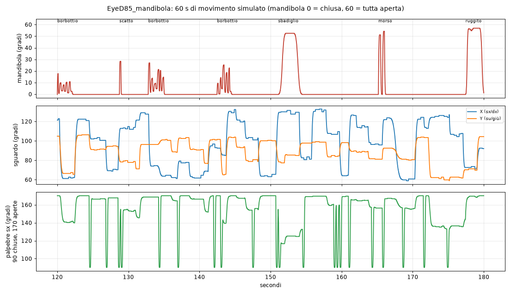

# EyeD85_mandibola — occhi D85 + mandibola (ESP8266 + PCA9685)

Uguale a [`EyeD85_random`](../EyeD85_random/README.md) per gli occhi (stessi canali, stessa taratura
`CAL_*`, stessi comandi) **più la mandibola**: il servo grande **DS3225 da 25 kg** sul **canale 0** della
stessa PCA9685, che si muove anche lei a caso. `EyeD85_random` resta la versione **senza mandibola**.

## Collegamenti
| Canale PCA9685 | Servo |
|---|---|
| **0** | **mandibola** (DS3225) |
| 4 | X — i due bulbi sinistra/destra |
| 6 | Y — i due bulbi su/giù |
| 10 / 11 | palpebre sinistra / destra |

ESP8266 ↔ PCA9685 come in `EyeD85_random` (SDA = D2, SCL = D1, VCC = 3V3).

**Alimentazione**: il DS3225 (4.8–6.8 V) assorbe fino a 2–3 A negli spunti e da bloccato, più i 4 servo degli
occhi. Serve un alimentatore **5–6 V da almeno 6 A** (meglio 10 A), GND in comune con la scheda, e un
condensatore da 1000 µF o più. Il rosso/nero del DS3225 conviene portarli **direttamente all'alimentatore**
con fili grossi: dal canale 0 della PCA9685 prendere solo il segnale.

## Taratura della mandibola (da fare insieme sulla testa)
In `config.h`: `CAL_JAW = { 0, 60 }` = gradi a bocca **chiusa** e **tutta aperta** (bocca da mostro: anche 70).
1. Caricare lo sketch **senza** la squadretta sul servo: all'accensione va a 0° (chiusa). Montare la squadretta
   con la bocca chiusa.
2. Monitor seriale 115200: `m10`, `m30`, `m60`, `m70`… portano e tengono la mandibola a quei gradi (occhi al
   centro, palpebre aperte). Per sicurezza non va mai oltre 90° dalla chiusura.
3. **Chiusa** = denti che si toccano appena, **non oltre**: un servo da 25 kg che spinge contro il cranio va in
   stallo, scalda e rompe i pezzi. **Aperta** = quanto si vuole.
4. Scrivere i due valori in `CAL_JAW`, ricaricare. `n` mostra le 5 azioni una dopo l'altra, `m` ne fa una a caso,
   `r` riparte.

Se la mandibola si apre al contrario, scambiare i due valori (es. `{ 60, 0 }`, squadretta rimontata) o usare l'altro
lato della corsa (es. `{ 180, 120 }`). Il DS3225 esiste in versione **180°** e **270°** (c'è scritto
sull'etichetta o sulla scatola): con la 270° mettere `JAW_DEG_SPAN = 270`, altrimenti i gradi non tornano.

## Cosa fa la mandibola
| Azione | Come | Più frequente quando l'umore è |
|---|---|---|
| morso | apre di scatto e chiude di colpo; a volte 3–5 di fila con aperture più piccole (denti che battono) | agitato |
| ruggito | spalancata, trema, resta aperta 0.3–1.2 s, richiude lenta; **occhi sgranati**, niente battiti | agitato, curioso |
| sbadiglio | lento, tutta aperta, ferma 0.7–2 s, chiude lenta; **palpebre che calano**, poi spesso un battito | assonnato |
| borbottio | 3–9 piccole aperture irregolari, come se parlasse | calmo, curioso |
| scatto | piccolo tic nervoso, a volte doppio | sempre |

Tra un'azione e l'altra 2.5–9 s (più spesso da agitato, meno da assonnato); a riposo chiusa (`JAW_REST`).
Mai più veloce di quanto il servo riesce a seguire (`JAW_FULL_MS` = tempo minimo per tutta la corsa).

## Comandi (Monitor seriale 115200)
Quelli di `EyeD85_random` (`c`, `1`–`9`, `r`, `b`, `w`, `s`) più:
- `m` — un'azione della mandibola a caso, adesso;
- `n` — le 5 azioni in fila (morso, ruggito, sbadiglio, borbottio, scatto), per vederle;
- `m45` — **taratura**: mandibola ferma a 45 gradi (decimali ammessi), occhi al centro; `r` per ripartire.

## Regolazioni (`config.h`)
- `CAL_JAW`, `JAW_DEG_SPAN` — taratura e versione del servo;
- `JAW_EVENT_MIN_MS` / `JAW_EVENT_MAX_MS` — quanto spesso si muove;
- `JAW_FULL_MS` — aumentarlo (es. 300) se nei morsi la mandibola non arriva in fondo (pezzi pesanti);
- `JAW_REST` — apertura a riposo (0.05 = un filo aperta, inquietante);
- `JAW_SYNC_EYES` — 0 = occhi e mandibola indipendenti;
- nel `.ino`, tabella `JAW_W`: quanto è probabile ogni azione per ogni umore.

## Verificato
Compilato per **NodeMCU 1.0 (ESP-12E Module)**, core esp8266 3.1.2: 250 KB di flash (23 %), RAM 37 %, nessun
avviso. Simulato sul PC (stesso codice con PCA9685 finta), 4 × 30 minuti: mandibola sempre tra 0 e 60°, ogni
morso arriva in fondo anche con un servo rallentato dal peso (200°/s), occhi spalancati durante i ruggiti,
comandi `m`, `m45`, `n`, `r` provati. **Non ancora provato col servo vero.**
