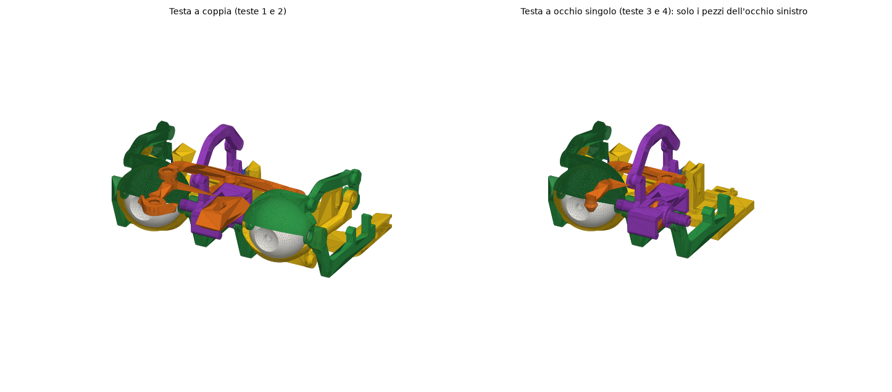

# EyeMech D85 — piatti di stampa delle teste dell'Idra

Stampante: **Bambu Lab A1** (piatto 256 × 256), PLA, 0.20 mm. In ogni piatto ci sono più pezzi possibile
(incastrati sulle impronte reali, ≥ 4 mm tra i pezzi, 3 mm dal bordo) per fare meno stampe possibile.

## Stato

| Testa | Occhi | Stato | Cosa resta da stampare | Cartella |
|---|---|---|---|---|
| 1 | coppia | ✅ completa (palpebre versione precedente, con `PinB` e vite) | niente (facoltativo: 1 piatto per le palpebre nuove) | [`Testa_1/`](Testa_1/) |
| 2 | coppia | 🟡 basi stampate, bulbi già pronti | **3 piatti**, ~23 h 10 min, ~0.59 kg | [`Testa_2/da_stampare/`](Testa_2/da_stampare/) |
| 3 | singolo (sx) | ⏳ da stampare | **3 piatti**, ~21 h 20 min, ~0.60 kg (solo pezzi dell'occhio sinistro) | [`Testa_3_occhio_singolo/da_stampare/`](Testa_3_occhio_singolo/da_stampare/) |
| 4 | singolo (sx) | ⏳ da stampare | **3 piatti**, ~21 h 20 min, ~0.60 kg (uguale alla 3) | [`Testa_4_occhio_singolo/da_stampare/`](Testa_4_occhio_singolo/da_stampare/) |
| | | | **Totale: 9 piatti, ~66 h, ~1.8 kg** | |

**Palpebre (teste 2, 3, 4)**: tutte le palpebre di un lato in **un pezzo solo, già montate** (`Palpebre_L_PIP`,
`Palpebre_R_PIP`): palpebra superiore + tirante + squadretta + `LinkB` + palpebra inferiore, con i giunti
print-in-place biconici come quelli di Will (anche quello tra squadretta e `LinkB`, che prima era un `PinB` con
la vite). Dopo la stampa: togliere i supporti e muovere a mano i giunti finché girano liberi. Disegni in
`docs/img/giunto_biconico_sezione.png` e `docs/img/palpebre_PIP_pezzo.png`.

Tempi e grammi con `~` sono stime (per ogni pezzo la media misurata nei G-code dei piatti della testa 1, supporti
compresi): quelli esatti li dà Bambu Studio dopo *Slice*.

## Cartelle

| Cartella | Contenuto |
|---|---|
| `pezzi/` | un STL per pezzo, nell'orientamento di stampa (li genera `mechanical/scripts/generate_eyemech.py`) |
| `info.txt` | quote, servo, viteria, ingombri dei pezzi |
| `Testa_1/` | i 5 piatti (già tagliati) con cui è stata stampata la testa 1; `aggiornamento_palpebre/` = 1 piatto facoltativo con le palpebre nuove |
| `Testa_2/gia_stampati/` | il piatto delle basi della testa 2, già stampato (lo stesso piatto 1 della testa 1) |
| `Testa_2/da_stampare/` | i 3 piatti con tutto il resto della testa 2, **senza i bulbi** (già pronti) |
| `Testa_3_occhio_singolo/da_stampare/` | 3 piatti: la testa 3 completa, solo pezzi dell'occhio sinistro |
| `Testa_4_occhio_singolo/da_stampare/` | 3 piatti: la testa 4 completa (uguale alla 3) |

Ogni cartella `Piatto_<X>` ha il progetto Bambu Studio (`.3mf`), gli STL già posizionati e `piatto.png` con la
disposizione; ogni cartella di piatti ha `layout_piatti.json` (pezzo, rotazione e posizione su ogni piatto) e un
`README.md` con contenuto, tempi e grammi di ogni piatto. I progetti nuovi (teste 2, 3, 4) **non sono tagliati**:
si aprono in Bambu Studio, si controlla piatto e supporti (già attivi, tree(auto) 30°) e si preme *Slice*.

## Testa a occhio singolo (teste 3 e 4)

Stesso meccanismo D85 con **un solo occhio, il sinistro**, e **solo i pezzi che gli servono**: i pezzi del lato
destro non si stampano e quelli che servono a tutti e due gli occhi sono accorciati.



**Cosa c'è e cosa no rispetto a una testa a coppia** (meccanismo D85 con il solo occhio sinistro, 3 servo:
X, Y e palpebre sinistre):

| | Coppia | Occhio singolo |
|---|---|---|
| Bulbi | 2 | **1** |
| Palpebre (già montate) | `Palpebre_L_PIP` + `Palpebre_R_PIP` | **solo `Palpebre_L_PIP`** |
| Supporti esterni | `PivotOuter_L` + `PivotOuter_R` | **solo `PivotOuter_L`** |
| Supporti centrali | 2 `PivotCentral` | 2 `PivotCentral` (il destro regge il perno destro del `CoreY`) |
| Asse X, telaio | `XAxisA_PIP`, 264 mm | **`XAxisA_singolo`, 155 mm**: via braccio e adattatore destri |
| Asse X, tirante | `XAxisB_PIP`, 264 mm | **`XAxisB_singolo`, 143 mm**: via braccio e adattatore destri |
| Telaio Y | `CoreY_PIP` | `CoreY_PIP` (uguale) |
| Base | `Base_L` + `Base_R` (194 mm) + 2 chiavette | `Base_L` + **`Base_R_singolo` (75 mm)** + 2 chiavette: via la sede del servo delle palpebre destre e del supporto esterno destro; restano mezza sede del servo Y, il supporto centrale destro, mezza linguetta PCA9685 e il foro Ø12 per il supporto della mandibola |

In tutto **12 pezzi in 3 piatti** (~21 h 20 min, ~0.60 kg) invece dei 15 pezzi, più lunghi, di una testa a coppia.

- Il tirante dell'asse X (`XAxisB_singolo`) fa il parallelogramma tra la squadretta del servo X e l'adattatore
  dell'occhio sinistro, come nella coppia: basta un occhio.
- Il `CoreY` resta uguale: gira tra i due supporti centrali, quindi anche quello destro serve.
- Occhio a destra invece che a sinistra: bisognerebbe tagliare i pezzi al contrario (`singolo()` in
  `generate_eyemech.py`) e usare i `_R`.

## Rifare i piatti

Dopo aver rigenerato i pezzi (`generate_eyemech.py`), rimettere gli STL nuovi nelle stesse posizioni:
```bash
pip install trimesh shapely scipy matplotlib
python mechanical/scripts/teste_D85.py costruisci mechanical/eyes/eyemech_D85/Testa_2/da_stampare            # STL, 3MF, png, tabella
python mechanical/scripts/teste_D85.py costruisci mechanical/eyes/eyemech_D85/Testa_2/da_stampare --taglia   # sul PC: anche lo slicing
```
Se un pezzo cambia ingombro e la distanza minima stampata scende sotto ~3 mm, la disposizione va rifatta:
```bash
python mechanical/scripts/teste_D85.py impacchetta coppia_senza_basi_occhi 3        # testa 2
python mechanical/scripts/teste_D85.py impacchetta singolo 3                         # una testa a occhio singolo
```
e il JSON stampato va in `layout_piatti.json` (un piatto per elenco, con un nome).
