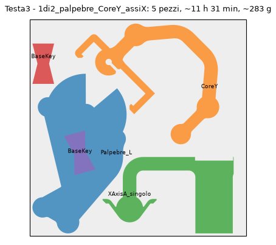
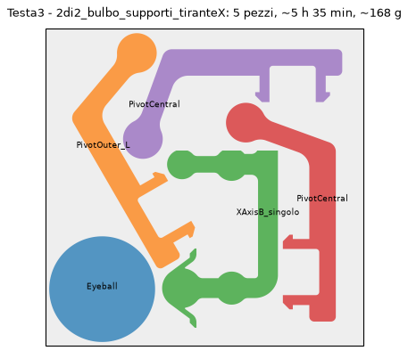

# Testa 3 — occhio singolo — ⏳ DA STAMPARE

**2 piatti = 2 file**, qui sotto: con la **base già stampata** (`Base_L` + metà destra) danno la testa 3 completa
(solo i pezzi dell'occhio sinistro; la testa 4 ha i suoi file uguali nella sua cartella). Le 2 chiavette della base
sono nel piatto 1: se le hai già, puoi toglierle in Bambu Studio prima di tagliare.

Se la metà destra della base stampata è quella intera (`Base_R`, 194 mm) e non quella corta (`Base_R_singolo`, 75 mm)
va bene lo stesso: la parte in più (sede del servo delle palpebre destre) resta vuota.

## Come mandare in stampa un piatto
1. Aprire il file `.3mf` del piatto in **Bambu Studio** (doppio clic, o File → Apri progetto): i pezzi sono già
   disposti e le impostazioni già scelte (A1 0.4, 0.20 mm, Bambu PLA Basic, supporti tree(auto) 30°, piatto
   Textured PEI).
2. Controllare in alto il tipo di piatto e in Processo → Supporto che *Abilita supporti* sia attivo.
3. **Taglia piatto** (Slice), poi **Stampa piatto** per mandarlo alla A1, oppure *Esporta G-code del piatto* su
   microSD e sceglierlo dallo schermo della stampante.
4. Spuntare la riga nella tabella.

Dopo la stampa: nei pezzi print-in-place (palpebre, `CoreY`, assi X) togliere i supporti e muovere a mano i giunti
finché girano liberi; le palpebre (`Palpebre_L_PIP`, piatto 1) escono già montate.

Cosa contiene la testa e cosa è stato tolto rispetto a una testa a coppia: [`../README.md`](../README.md#testa-a-occhio-singolo-teste-3-e-4).
Nella cartella: `anteprime/` = immagini dei piatti, `stl/` = gli stessi pezzi già posizionati (di riserva),
`layout_piatti.json` = disposizione (per rifare i file con `mechanical/scripts/teste_D85.py costruisci`). Le basi
(se servissero di nuovo) sono in `../pezzi/` (`Base_L.stl`, `Base_R_singolo.stl`).

<!-- tabella piatti: generata da mechanical/scripts/teste_D85.py -->

| Stampato | File da aprire in Bambu Studio | Pezzi | Contenuto | Tempo | Filamento | Altezza max |
|---|---|---|---|---|---|---|
| ☐ | [`Testa3_1di2_palpebre_CoreY_assiX.3mf`](Testa3_1di2_palpebre_CoreY_assiX.3mf) | 5 | `Palpebre_L_PIP` + `CoreY_PIP` + `XAxisA_singolo` + 2 `BaseKey` | ~11 h 31 min | ~283 g | 122 mm |
| ☐ | [`Testa3_2di2_bulbo_supporti_tiranteX.3mf`](Testa3_2di2_bulbo_supporti_tiranteX.3mf) | 5 | `Eyeball` + `PivotOuter_L` + `XAxisB_singolo` + 2 `PivotCentral` | ~5 h 35 min | ~168 g | 53 mm |
| | **Totale** | **10** | **2 piatti** | **~17 h 05 min** | **~0.45 kg** | |

Tempi e grammi con `~` sono stime (media per pezzo misurata nei G-code dei piatti della testa 1, supporti compresi, senza riscaldamento e calibrazione iniziale): quelli esatti li dà Bambu Studio dopo *Slice*.
