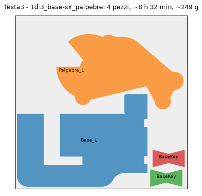
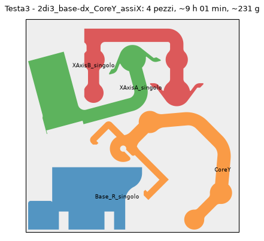
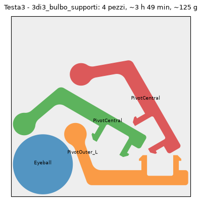

# Testa 3 — occhio singolo — ⏳ DA STAMPARE

**3 piatti = 3 file**, qui sotto. Stampati tutti e 3 danno la testa 3 completa (solo i pezzi dell'occhio
sinistro; la testa 4 ha i suoi file uguali nella sua cartella).

## Come mandare in stampa un piatto
1. Aprire il file `.3mf` del piatto in **Bambu Studio** (doppio clic, o File → Apri progetto): i pezzi sono già
   disposti e le impostazioni già scelte (A1 0.4, 0.20 mm, Bambu PLA Basic, supporti tree(auto) 30°, piatto
   Textured PEI).
2. Controllare in alto il tipo di piatto e in Processo → Supporto che *Abilita supporti* sia attivo.
3. **Taglia piatto** (Slice), poi **Stampa piatto** per mandarlo alla A1, oppure *Esporta G-code del piatto* su
   microSD e sceglierlo dallo schermo della stampante.
4. Spuntare la riga nella tabella.

Dopo la stampa: nei pezzi print-in-place (palpebre, `CoreY`, assi X) togliere i supporti e muovere a mano i giunti
finché girano liberi; le palpebre (`Palpebre_L_PIP`, piatto 1) escono già montate.

Cosa contiene la testa e cosa è stato tolto rispetto a una testa a coppia: [`../README.md`](../README.md#testa-a-occhio-singolo-teste-3-e-4).
Nella cartella: `anteprime/` = immagini dei piatti, `stl/` = gli stessi pezzi già posizionati (di riserva),
`layout_piatti.json` = disposizione (per rifare i file con `mechanical/scripts/teste_D85.py costruisci`).

<!-- tabella piatti: generata da mechanical/scripts/teste_D85.py -->

| Stampato | File da aprire in Bambu Studio | Pezzi | Contenuto | Tempo | Filamento | Altezza max |
|---|---|---|---|---|---|---|
| ☐ | [`Testa3_1di3_base-sx_palpebre.3mf`](Testa3_1di3_base-sx_palpebre.3mf) | 4 | `Base_L` + `Palpebre_L_PIP` + 2 `BaseKey` | ~8 h 32 min | ~249 g | 122 mm |
| ☐ | [`Testa3_2di3_base-dx_CoreY_assiX.3mf`](Testa3_2di3_base-dx_CoreY_assiX.3mf) | 4 | `Base_R_singolo` + `CoreY_PIP` + `XAxisA_singolo` + `XAxisB_singolo` | ~9 h 01 min | ~231 g | 112 mm |
| ☐ | [`Testa3_3di3_bulbo_supporti.3mf`](Testa3_3di3_bulbo_supporti.3mf) | 4 | `Eyeball` + `PivotOuter_L` + 2 `PivotCentral` | ~3 h 49 min | ~125 g | 53 mm |
| | **Totale** | **12** | **3 piatti** | **~21 h 22 min** | **~0.60 kg** | |

Tempi e grammi con `~` sono stime (media per pezzo misurata nei G-code dei piatti della testa 1, supporti compresi, senza riscaldamento e calibrazione iniziale): quelli esatti li dà Bambu Studio dopo *Slice*.
