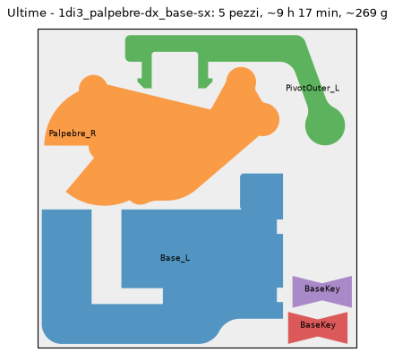
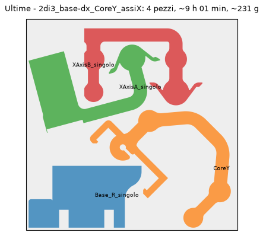
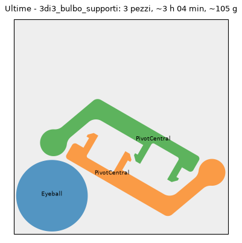

# Ultime stampe: palpebre mancanti + l'ultimo occhio singolo

**3 piatti = 3 file.** Il primo contiene le **palpebre che mancano**: si può mandare in stampa subito.

## Le palpebre che mancano: `Palpebre_R_PIP`
Gli ultimi 3 progetti aperti in Bambu Studio sul PC (`Testa4_1di2_palpebre_CoreY_assiX`,
`Testa3_1di2_palpebre_CoreY_assiX`, `Testa3_1di3_base-sx_palpebre`) hanno tutti `Palpebre_L_PIP`: i "3 occhi uguali"
sono 3 gruppi **L**, quindi manca il gruppo **R**.
- `L` = palpebre dell'occhio **destro della maschera** (a **sinistra** guardando la maschera da davanti);
- `R` = palpebre dell'occhio **sinistro della maschera** (a **destra** guardando la maschera da davanti).

Controllo veloce sui pezzi stampati: tenendo le palpebre come stanno nella maschera, viste da davanti, la
squadretta del servo e i tiranti stanno sul **lato esterno** dell'occhio: a **sinistra** nei gruppi `L`, a
**destra** nei gruppi `R`. Se le 3 che hai hanno la squadretta a sinistra, ti manca proprio questa.

## L'ultimo occhio singolo
Gli altri pezzi sono tutta la testa a occhio singolo, basi comprese: `Base_L` + `Base_R_singolo` (le 2 metà della
base) + 2 chiavette, bulbo, `PivotOuter_L`, 2 `PivotCentral`, `CoreY`, `XAxisA_singolo`, `XAxisB_singolo`.
Non ci sono le sue palpebre (`Palpebre_L_PIP`): sono tra le 3 già stampate. Se invece servissero, sono in
`../pezzi/Palpebre_L_PIP.stl` (o nei piatti 1 delle teste 3 e 4).

## Come mandare in stampa un piatto
Aprire il file `.3mf` in **Bambu Studio** (pezzi già disposti, A1 0.4, 0.20 mm, PLA Basic, supporti tree(auto)
30°, piatto Textured PEI), controllare piatto e supporti, **Taglia piatto**, **Stampa piatto**. Dopo la stampa: nei
pezzi print-in-place (palpebre, `CoreY`, assi X) togliere i supporti e muovere a mano i giunti finché girano liberi.
Anteprime in `anteprime/`, STL di riserva in `stl/`.

<!-- tabella piatti: generata da mechanical/scripts/teste_D85.py -->

| Stampato | File da aprire in Bambu Studio | Pezzi | Contenuto | Tempo | Filamento | Altezza max |
|---|---|---|---|---|---|---|
| ☐ | [`Ultime_1di3_palpebre-dx_base-sx.3mf`](Ultime_1di3_palpebre-dx_base-sx.3mf) | 5 | `Base_L` + `Palpebre_R_PIP` + `PivotOuter_L` + 2 `BaseKey` | ~9 h 17 min | ~269 g | 122 mm |
| ☐ | [`Ultime_2di3_base-dx_CoreY_assiX.3mf`](Ultime_2di3_base-dx_CoreY_assiX.3mf) | 4 | `Base_R_singolo` + `CoreY_PIP` + `XAxisA_singolo` + `XAxisB_singolo` | ~9 h 01 min | ~231 g | 112 mm |
| ☐ | [`Ultime_3di3_bulbo_supporti.3mf`](Ultime_3di3_bulbo_supporti.3mf) | 3 | `Eyeball` + 2 `PivotCentral` | ~3 h 04 min | ~105 g | 53 mm |
| | **Totale** | **12** | **3 piatti** | **~21 h 22 min** | **~0.60 kg** | |

Tempi e grammi con `~` sono stime (media per pezzo misurata nei G-code dei piatti della testa 1, supporti compresi, senza riscaldamento e calibrazione iniziale): quelli esatti li dà Bambu Studio dopo *Slice*.
