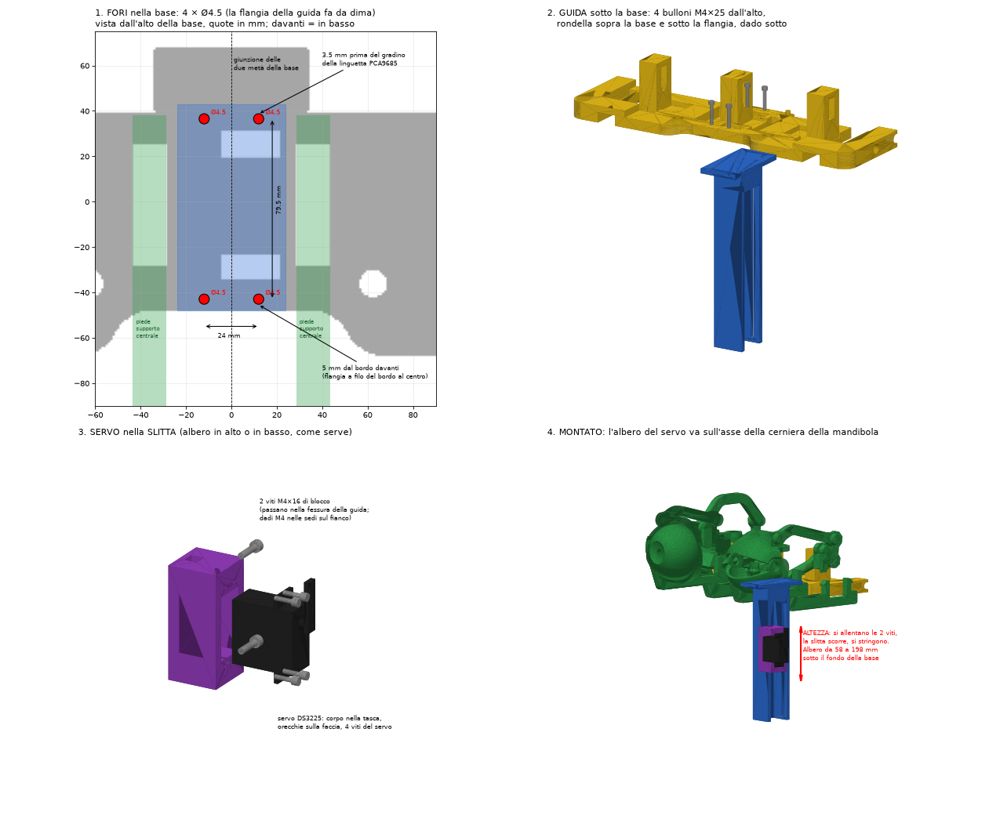

# Supporto del servo della mandibola (DS3225, 25 kg)

Due pezzi stampati che portano il servo grande della mandibola **sotto la base degli occhi**, con
l'**altezza regolabile**: si trova il punto in cui l'albero del servo combacia con la cerniera della
mandibola, si stringono 2 viti e il servo muove la mandibola (firmware: `firmware/EyeD85_mandibola`, canale 0
della PCA9685).

| Pezzo | Cosa fa |
|---|---|
| `Guida` | **flangia** che si imbullona sotto la base con **4 bulloni M4** + **canale verticale** a U lungo 220 mm, aperto verso il lato dell'albero del servo e in basso, con una fessura verticale sul fianco |
| `Slitta_DS3225` | **incasso preciso del servo**: il corpo entra nella tasca, le orecchie appoggiano sulla faccia e si fissano con le 4 viti del servo. Scorre nel canale (0.3 mm di gioco per lato) e si blocca con **2 viti M4** che passano nella fessura della guida e si avvitano nei dadi infilati nel fianco della slitta |

L'albero del servo resta orizzontale e parallelo all'asse degli occhi; regolazione in altezza: **albero da 58 a
198 mm sotto il fondo della base** (il servo si può montare nella slitta con l'albero in alto o in basso).

## Fori nella base (4 × Ø4.5)
Posizione di serie, uguale per le teste a coppia e per quelle a occhio singolo (vedi il disegno, riquadro 1):
- centrata sulla **giunzione delle due metà della base**, fori a **12 mm** a destra e a sinistra (24 mm tra loro);
- fila davanti a **5 mm dal bordo anteriore della base al centro** (il bordo dell'arco), fila dietro **79.5 mm** più
  indietro (3.5 mm prima del gradino della linguetta PCA9685).

In quei 4 punti la base è piena (12.8 mm) e la flangia sta tra i piedi dei supporti centrali. Basta appoggiare la
**flangia sotto la base**, centrata sulla giunzione e col bordo davanti a filo del bordo della base, segnare i 4
fori e forare con punta da 4.5. Se nella testa serve il servo da un'altra parte si può forare dove si vuole (la
flangia fa da dima), purché la base sotto sia piatta e la flangia non tocchi i piedi dei supporti.

## Viti (per testa)
| Dove | Viti | Dadi | Rondelle |
|---|---|---|---|
| Guida → base | 4 × **M4×25** dall'alto | 4 × M4 sotto la flangia | 8 × M4 (sopra la base e sotto la flangia) |
| Slitta → guida (blocco altezza) | 2 × **M4×16** | 2 × M4 nelle sedi sul fianco della slitta | 2 × M4 |
| Servo → slitta | le 4 viti del servo (o 4 autofilettanti ~3×12) | — | — |

## Montaggio
1. Forare la base (sopra) e imbullonare la **guida** sotto la base: bulloni dall'alto, rondella sopra la base e
   sotto la flangia, dado sotto.
2. Infilare i **2 dadi M4** nelle sedi esagonali sul fianco della slitta.
3. Mettere il **servo nella slitta**: corpo nella tasca (il cavo esce dal passaggio in fondo alla tasca),
   orecchie sulla faccia, 4 viti del servo. Albero in alto o in basso, come serve.
4. Infilare la **slitta nel canale dal basso**, col servo verso il lato aperto e i dadi verso la fessura.
5. Le **2 viti M4×16** con rondella attraverso la fessura nei dadi della slitta, poco strette: far scorrere la
   slitta finché l'albero è sull'asse della cerniera della mandibola, poi stringere.
6. Squadretta del servo sulla mandibola. Taratura della corsa (chiusa / aperta) col firmware: comando `m<gradi>`
   (es. `m35`) e `CAL_JAW` in `firmware/EyeD85_mandibola/config.h`.

La guida si può montare anche **girata di 180°** (i 4 fori sono simmetrici): così l'albero del servo va
dall'altra parte.

## Stampa
In `stampa/`, un file per piatto (progetti Bambu Studio già disposti, da tagliare; anteprime in `stampa/anteprime/`):
- `Mandibola_supporto_1_set.3mf` — guida + slitta per **una testa**;
- `Mandibola_supporto_4_set.3mf` — **4 set** (tutte le teste) in un solo piatto.

Impostazioni salvate nel progetto: PLA 0.20 mm, **4 pareti, riempimento 25% gyroid, senza supporti** (non
servono), piatto Textured PEI. La guida si stampa in piedi sulla flangia (alta 226 mm), la slitta sul dorso.
Stima grossolana: ~4 h e ~140 g per set (Bambu Studio dà i valori esatti).

Verificato al computer con tutto il meccanismo degli occhi e la base: nessuna interferenza con la slitta in alto
e in basso, albero su e giù; bulloni, dadi e servo liberi; la parte del servo che sporge resta sempre sotto i
piedi dei supporti. Servo vero non ancora provato.

Rigenerare pezzi e piatti: `python mechanical/mandibola/supporto_mandibola.py` (quote del servo in `SV`, della
slitta in `SL`, della guida e dei fori in `GD`).
Il supporto precedente (traversa + braccio + culla, regolabile in 3 direzioni, appeso ai 2 fori Ø12) è sul ramo
`archivio`.
