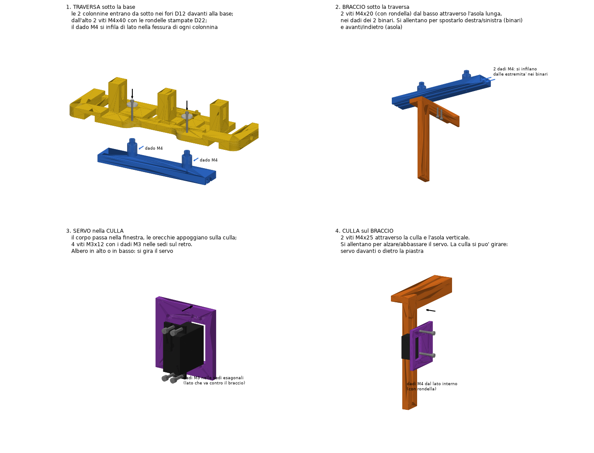
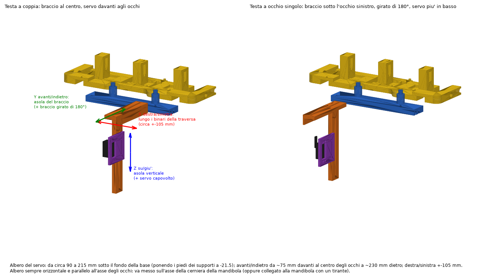
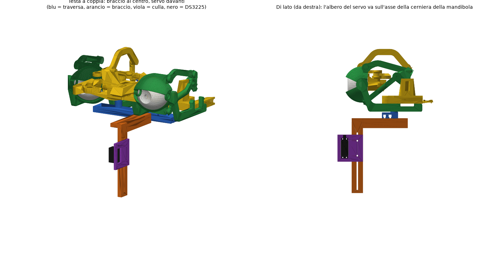

# Supporto regolabile del servo della mandibola (DS3225, 25 kg)

Si appende alla **base degli occhi D85 senza modificarla** e porta il servo della mandibola dove serve in ogni
maschera: **destra/sinistra, avanti/indietro, su/giù**. L'albero del servo resta orizzontale e parallelo
all'asse degli occhi: va messo **sull'asse della cerniera della mandibola** (la squadretta metallica del servo
si avvita alla mandibola) oppure collegato alla mandibola con un tirante.

Servo: **DS3225 (Red)** di Dsservo, "25KG" sul frontale rosso. Quote dal datasheet: corpo 40 × 20 × 40.5 mm,
orecchie 54.5 mm con fori a 49.5 × 10 mm, faccia sotto le orecchie a 27.7 mm dal fondo, albero a circa 10 mm
dall'estremità del corpo (da controllare col calibro sul servo vero prima di stampare). Coppia 24.5 kg·cm a 5 V,
28 kg·cm a 6.8 V, spunto fino a 2.9 A.

## Pezzi (cartella `pezzi/`, già nella posa di stampa)

| Pezzo | Cosa fa |
|---|---|
| `Traversa` | barra lunga 246 mm. Le **2 colonnine** entrano da sotto nei **2 fori Ø12 davanti alla base** (quelli di Will, a 62.7 mm dal centro) e la tengono 24 mm sotto la base: così passa **sotto i piedi dei supporti a L**, che sporgono 21.5 mm sotto la base. Sotto ha **2 binari a T** per dadi M4: il braccio scorre a **destra/sinistra** (±105 mm) |
| `Braccio` | piastra orizzontale con **asola lunga** (avanti/indietro) e piastra verticale sul fianco con **asola verticale** (su/giù). Si può montare **girato di 180°**: la piastra verticale passa dall'altro lato e dall'altra parte |
| `Culla_DS3225` | tiene il servo per le orecchie: il corpo passa nella finestra, 4 viti M3 con i dadi nelle sedi esagonali. Si avvita all'asola verticale del braccio, col servo **davanti o dietro** la piastra; il servo si può girare con l'albero **in alto o in basso** |
| `Rondella_x2` | 2 rondelle Ø22 per le viti della traversa: stanno sopra la base, a cavallo dei fori Ø12 |

## Viti (per ogni testa)

| Dove | Viti | Dadi | Rondelle |
|---|---|---|---|
| Base → traversa | 2 × **M4×40** a testa cilindrica | 2 × M4, nella fessura laterale di ogni colonnina | le 2 rondelle stampate (sopra la base) |
| Traversa → braccio | 2 × **M4×20** | 2 × M4, uno per binario | 2 × M4 sotto le teste |
| Braccio → culla | 2 × **M4×25** | 2 × M4 | 4 × M4 |
| Culla → servo | 4 × **M3×12** | 4 × M3, nelle sedi della culla | — |

In tutto, per testa: M4×40 ×2, M4×25 ×2, M4×20 ×2, M3×12 ×4, dadi M4 ×6, dadi M3 ×4, rondelle M4 ×6.

## Montaggio

1. **Traversa**: infilare un dado M4 nella fessura di ogni colonnina (dal retro). Le colonnine entrano da sotto
   nei 2 fori Ø12 davanti alla base. Dall'alto: rondella stampata + vite M4×40 in ogni foro, fino al dado.
2. **Dadi dei binari**: far scorrere 2 dadi M4 nei binari della traversa, uno per binario, dalle estremità.
3. **Braccio**: sotto la traversa, con le 2 viti M4×20 (con rondella) dal basso attraverso l'asola lunga, nei
   due dadi. Viti allentate: si sposta destra/sinistra lungo i binari e avanti/indietro lungo l'asola.
4. **Servo nella culla**: il corpo passa nella finestra, le orecchie appoggiano sulla culla, 4 viti M3×12 con i
   dadi M3 nelle sedi esagonali (lato della culla che va contro il braccio).
5. **Culla sul braccio**: 2 viti M4×25 attraverso la culla e l'asola verticale, dadi dall'altro lato.
   Viti allentate: il servo si alza e si abbassa.
6. Con la mandibola montata: portare l'albero sull'asse della cerniera, poi stringere tutte le viti.

## Regolazioni

| Direzione | Come | Corsa |
|---|---|---|
| destra / sinistra | braccio lungo i binari della traversa | ±105 mm dal centro |
| avanti / indietro | asola lunga del braccio (+ braccio girato di 180°) | albero da ~75 mm davanti al centro degli occhi a ~230 mm dietro |
| su / giù | asola verticale (+ servo con l'albero in basso) | albero da ~90 a ~215 mm sotto il fondo della base |

Per le teste a occhio singolo vanno gli stessi pezzi: il braccio si può mettere sotto l'occhio (es. 100 mm a
sinistra) o dove serve.

**Attenzione:**
- con la traversa montata il meccanismo non sta più in piedi sui piedi dei supporti (la traversa è 2.5 mm più
  bassa e il braccio scende sotto): la base va fissata nella testa in modo che sotto resti spazio per il braccio;
- i 2 fori Ø12 davanti alla base sono occupati dalle colonnine: se la base era fissata alla testa con quei fori,
  si può fissare la testa alla traversa.

Verificato al computer con tutto il meccanismo degli occhi montato: nessuna interferenza con base, supporti,
palpebre, bulbi e tiranti, col braccio al centro, sotto un occhio, davanti e dietro.

## Stampa

`stampa/Piatto_2_set/`: **2 set completi** (2 traverse, 2 bracci, 2 culle, 4 rondelle) su un piatto A1:
**stamparlo 2 volte per le 4 teste**. Progetto Bambu Studio già disposto (`Mandibola_Piatto_2_set.3mf`, non
tagliato) con PLA 0.20 mm, **4 pareti, riempimento 25% gyroid, senza supporti** (non servono), piatto Textured
PEI; STL già posizionati e `piatto.png`. Stima grossolana: **9–11 h e ~350 g per piatto** (il valore esatto lo dà
Bambu Studio). Il braccio si stampa capovolto con la piastra verticale in piedi (alta 200 mm), già orientata
lungo il movimento del piatto.

Rigenerare (pezzi + piatto): `python mechanical/scripts/mandibola_DS3225.py` (quote in testa allo script:
`SV` per il servo, `TR`, `AR`, `CR` per i pezzi).
